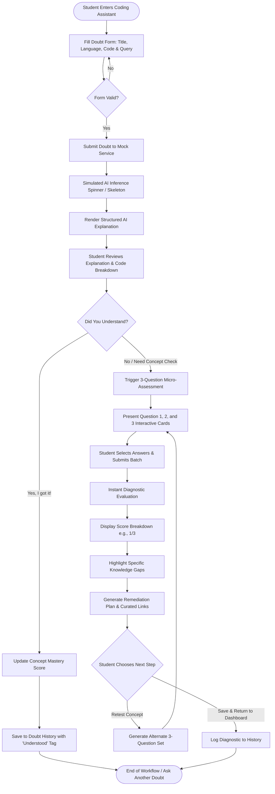
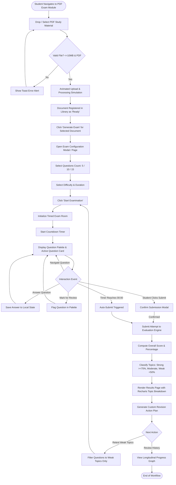
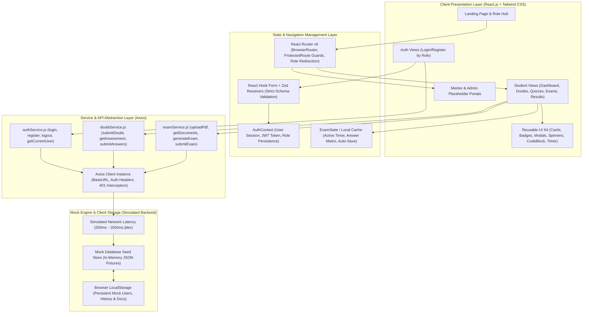

# System Architecture, Workflows & Matrices

**Project Title:** AI-Assisted Coding Doubt Resolution and Personalized Exam Preparation Platform  
**Document:** Workflows, Architecture, Matrices & Sitemap (MCA Minor Project Scope)  
**Version:** 1.0.0  

---

## 1. Feature-Scope Matrix

This matrix establishes clear boundaries between what is being delivered in this **Minor Project phase (Frontend + Mock Engine)**, what is earmarked for the **Major Project phase (Full-Stack + Live AI)**, and what is strictly **Out of Scope**.

| Feature / Functional Capability | Minor Project Scope (Delivered Now) | Major Project Scope (Planned Next Phase) | Out of Scope |
| :--- | :--- | :--- | :--- |
| **Authentication & Profile** | Multi-role registration & login (Student, Admin, Mentor), client-side Zod validation, token storage in `localStorage`, session restoration. | JWT authentication with refresh token rotation, OAuth2 (Google / GitHub), 2FA, email verification. | Biometric authentication, enterprise SSO (SAML/LDAP). |
| **Coding Doubt Input** | Rich multi-line editor with language selector (Python, Java, C++, JS, SQL), error message input field, character limit counters. | File upload for multi-file repositories, GitHub Gist integration, voice query input. | Live pair-programming screen sharing. |
| **AI Doubt Explanation** | Structured pedagogical view (overview, line-by-line breakdown, complexity analysis, code copy), simulated AI streaming/latency. | Real-time streaming response from LLM (Gemini 1.5 Pro / GPT-4o), dynamic code execution in sandbox (Piston/Judge0). | Audio-synthesized lecture generation. |
| **Did You Understand Check** | Explicit binary trigger ("Understood" vs. "Need Concept Check"). | Sentiment analysis on follow-up student chat messages to infer confusion. | Involuntary eye-tracking / webcam emotion detection. |
| **Formative 3-Question Diagnostic** | Exactly 3 interactive questions generated based on concept tag; instant evaluation, scoring, and rationale per option. | Adaptive computer testing (CAT) where question 2 & 3 dynamically scale difficulty based on question 1. | 100-question comprehensive standardized testing. |
| **Knowledge Gap Remediation** | Identification of missing prerequisite concepts, recommended reading links, and 1-click retest. | Direct integration with YouTube API / GeeksforGeeks API for auto-curated video playlists. | Live 1-on-1 private tutor dispatch. |
| **PDF Document Ingestion** | Drag-and-drop PDF uploader, file size (10MB) & MIME validation, extraction progress simulator, document library. | Server-side PDF text extraction (PyMuPDF / pdfplumber), OCR for scanned pages, chunking & vector embedding. | Support for protected audiobooks, scanned handwritten notes. |
| **Exam Configuration** | Customizable question count (5, 10, 15), difficulty levels, time duration limits (5 to 60 minutes). | Multi-document cross-synthesis, custom topic weighting (e.g. 70% Unit 2, 30% Unit 3). | Timetabled university cohort examination scheduling. |
| **Interactive Exam Room** | Live countdown timer, visual warning colors, question palette navigation (Answered, Unanswered, Marked for Review), auto-submit on timeout. | Fullscreen lockdown mode, tab-switch detection, randomized question shuffler. | AI webcam proctoring, face recognition anti-cheat. |
| **Exam Results & Analytics** | Overall percentage score, grade badges, topic strength vs. weakness breakdown (Recharts), correct answer rationales. | Longitudinal learning curve analytics, percentile ranking against class cohort. | Official accredited academic transcript generation. |
| **Personalized Revision Plan** | Filterable revision checklist focusing exclusively on weak topics (<50% accuracy), 1-click targeted retest. | Calendar integration with spaced repetition notifications (Anki-style SM-2 algorithm). | Automated homework assignment generation for teachers. |
| **Mentor Role** | Dedicated portal login, role-specific navigation, professional placeholder dashboard with upcoming feature roadmap. | Student escalation queue, review flagged doubts, mentor office hours scheduling, direct messaging. | Mentor billing, hourly payout processing, escrow payments. |
| **Admin Role** | Dedicated portal login, role-specific navigation, professional placeholder console with upcoming feature roadmap. | User administration, LLM API token consumption monitoring, system health metrics, content moderation. | Multi-institution white-labeling, SaaS subscription billing. |

---

## 2. Role & Permission Matrix

| Interface / Capability | Student (`ROLE_STUDENT`) | Mentor (`ROLE_MENTOR`) | Admin (`ROLE_ADMIN`) | Unauthenticated Guest |
| :--- | :---: | :---: | :---: | :---: |
| **Landing Page & Role Selection** | Full Access | Full Access | Full Access | Full Access |
| **Student Sign In / Sign Up** | Full Access | Restricted | Restricted | Full Access |
| **Mentor Sign In / Sign Up** | Restricted | Full Access | Restricted | Full Access |
| **Admin Sign In / Sign Up** | Restricted | Restricted | Full Access | Full Access |
| **Student Dashboard** | Full Access | Redirect / Forbidden | Redirect / Forbidden | Redirect to `/login/student` |
| **Ask Doubt & View AI Explanation** | Full Access | View Only (Planned) | View Only (Planned) | Redirect to `/login/student` |
| **Take 3-Question Assessment** | Full Access | Restricted | Restricted | Redirect to `/login/student` |
| **View Doubt History** | Full Access (Self) | Restricted | Restricted | Redirect to `/login/student` |
| **Upload PDF Study Material** | Full Access | Restricted | Restricted | Redirect to `/login/student` |
| **Generate & Take PDF Exam** | Full Access | Restricted | Restricted | Redirect to `/login/student` |
| **View Exam Results & Revision** | Full Access (Self) | Restricted | Restricted | Redirect to `/login/student` |
| **Mentor Placeholder Dashboard** | Redirect / Forbidden | Full Access | Full Access | Redirect to `/login/mentor` |
| **Admin Placeholder Dashboard** | Redirect / Forbidden | Redirect / Forbidden | Full Access | Redirect to `/login/admin` |
| **Sign Out** | Full Access | Full Access | Full Access | Not Applicable |

---

## 3. Complete Frontend Sitemap

```
/ (Landing Page)
├── /select-role (Role Selection Hub)
│
├── /login/:role (Sign In - student | mentor | admin)
├── /register/:role (Sign Up - student | mentor | admin)
│
├── /student (Protected - Student Role Required)
│   ├── /student/dashboard (Main Student Overview & Metric Cards)
│   │
│   ├── /student/coding-assistant (Module A - Ask Doubt & Explanation View)
│   ├── /student/doubt-assessment/:doubtId (Module A - 3-Question Formative Quiz)
│   ├── /student/assessment-results/:doubtId (Module A - Gap Analysis & Recommendations)
│   ├── /student/doubt-history (Module A - Past Doubts & Diagnoses)
│   │
│   ├── /student/documents (Module B - PDF Upload & Document Library)
│   ├── /student/exam-setup/:documentId (Module B - Configure Exam)
│   ├── /student/exam-room/:examId (Module B - Timed Interactive Exam)
│   ├── /student/exam-results/:attemptId (Module B - Detailed Results & Topic Mastery)
│   ├── /student/exam-history (Module B - Exam History & Score Trends)
│   └── /student/revision-plan/:attemptId (Module B - Personalized Revision Checklist)
│
├── /mentor (Protected - Mentor Role Required)
│   └── /mentor/dashboard (Mentor Placeholder Console)
│
├── /admin (Protected - Admin Role Required)
│   └── /admin/dashboard (Admin Placeholder Console)
│
└── /404 (Not Found Route)
```

---

## 4. Student Workflow Diagrams (Mermaid)

### 4.1 Workflow 1: Coding Doubt → Explanation → 3-Question Assessment → Recommendations



### 4.2 Workflow 2: PDF Upload → Exam Generation → Attempt → Results → Revision



---

## 5. High-Level System Architecture Diagram (Frontend Focused)



---

## 6. Frontend Responsibility Matrix

This matrix explicitly outlines the functional domains that the React frontend is responsible for executing autonomously in this phase:

| Functional Domain | Frontend Responsibility | Mock / Service Implementation |
| :--- | :--- | :--- |
| **Authentication Flow** | Form rendering, field validation (email regex, password length), role selection, auth token caching, route blocking, sign-out cleanup. | `authService.js` validates against mock user database in `localStorage` and returns simulated JWT token and user profile. |
| **Code Highlighting & Formatting** | Render multiline syntax highlighted code blocks with language badges, copy-to-clipboard button, and line numbering. | Pure client-side component using clean CSS and pre-formatted tags with token styles. |
| **Pedagogical Explanation Display** | Modular accordion/card rendering for Explanation, Code Fix, and Time/Space Complexity. | `doubtService.js` returns structured JSON response with realistic delay (1200ms). |
| **Formative 3-Question Quiz** | Render 3 question cards with radio/button choices, option selection highlighting, submission validation, and progress indicator. | `doubtService.js` retrieves 3 concept-specific questions with pre-configured answer keys and feedback strings. |
| **Knowledge Gap Profiling** | Calculate score (X / 3), compare selected answers with answer key, identify missed concept tags, and display targeted advice. | Client-side score evaluation logic coupled with mock recommendation templates. |
| **Document Upload & Validation** | File picker, drag-and-drop zone, file extension check (`.pdf`), size check (`<= 10MB`), animated progress bar (0% -> 100%). | `examService.js` records document metadata (name, size, simulated page count, ready status) into local storage. |
| **Exam Configuration** | Interactive controls for choosing document, question count (5, 10, 15), difficulty (Easy, Medium, Hard), and duration. | Validates options and generates an active exam session ID. |
| **Exam Room Countdown Timer** | `setInterval` timer tick, dynamic color shift (green -> amber -> red pulsating), warning toasts, and automatic submission handler when time reaches 00:00. | Client-side custom hook (`useExamTimer`) with `localStorage` tick backup to safeguard against accidental page refreshes. |
| **Question Palette Navigation** | 2D grid representing all questions with status color coding (Answered, Current, Unanswered, Marked for Review), jump-to-question handlers. | Pure client-side state machine tracking index and question status array. |
| **Topic Mastery Visual Analytics** | Visual charts (bar charts and radar graphs via Recharts) displaying topic-wise percentage mastery and strong/weak categorization. | Client-side calculation aggregating correct answers mapped to specific topic tags. |
| **Personalized Revision Checklist** | Filterable interactive checklist displaying specific revision actions prioritized by weakest topics first. | Client-side algorithm filtering topics with accuracy `< 50%` into checklist items. |
| **Mock Persistence Management** | Auto-hydration on application load, synchronization between Context and `localStorage`, and "Reset Demo Data" option. | Dedicated `mockDatabase.js` initialized on app bootstrap. |
